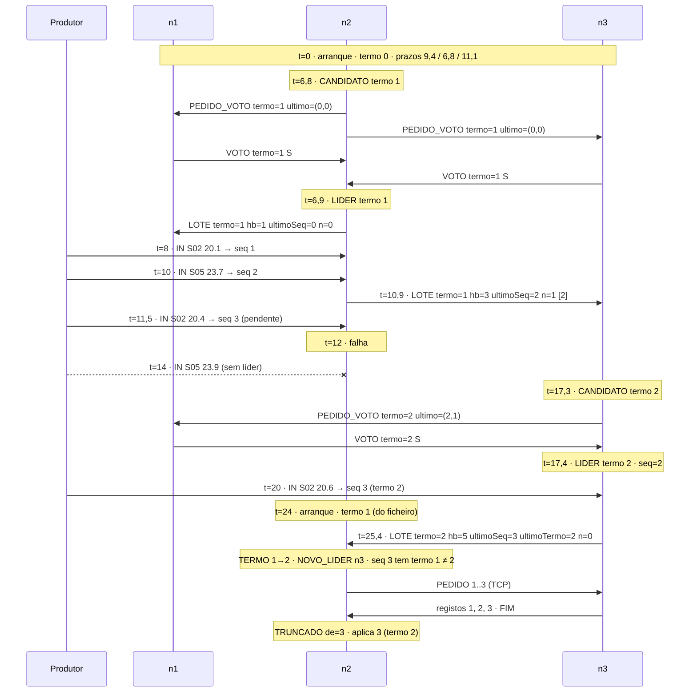

*Sistemas Distribuídos · Ficha prática*

# COMINDIR05 · Eleição do Líder de Partição

A presente ficha dá continuidade à ficha COMINDIR05. Nessa ficha, cada participante passou a **suspeitar** do líder de uma partição quando deixava de receber heartbeats, mas limitava-se a assinalá-lo. O líder era um processo fixo e, enquanto não voltasse a arrancar, a partição ficava sem um elemento que atribuísse números de sequência. 

Esta ficha introduz o conceito de **eleição do líder**. Cada partição de dados passa a ser servida por um **grupo de três nós** idênticos, em que qualquer um deles pode ser líder. No arranque do sistema, e sempre que o líder falha, os nós elegem um líder por **maioria de votos**, com um algoritmo semelhante ao do RAFT. Cada liderança pertence a um **termo**, um número inteiro crescente e persistente que garante que existe no máximo um líder por termo e que permite a qualquer nó reconhecer um líder obsoleto. O objetivo é compreender por que razão a eleição exige maioria, o que o termo garante e o que não garante, e de que forma o **teorema CAP** explica o comportamento do sistema quando a rede se particiona.

`Eleição de líder` · `RAFT` · `Termo` · `Quórum por maioria` · `Prazo de eleição aleatório` · `Voto dividido` · `Líder obsoleto` · `Teorema CAP` · `Partição de rede` · `Publish/Subscribe` · `IPFS`

## Enquadramento

### Ponto de partida

Na ficha anterior, o líder da partição *k* publica a cada Δ um `LOTE` que serve de heartbeat e de envio em lote, e os participantes mantêm um detetor de falhas que passa a `SUSPEITO` após `TIMEOUT` sem heartbeats. A ficha deixou duas questões em aberto. Primeiro, **detetar não é recuperar**: enquanto o líder não volta a arrancar, todas as leituras enviadas para a partição perdem-se. Segundo, se cada réplica decidisse, isoladamente, assumir a liderança ao suspeitar do líder, duas réplicas poderiam fazê-lo ao mesmo tempo e atribuir o **mesmo** `seq` a leituras diferentes.

A presente ficha resolve a primeira questão com uma eleição e a segunda com duas regras: um nó só é líder se tiver os votos de uma **maioria** do grupo, e cada nó vota no máximo uma vez por **termo**. Como duas maiorias de um grupo de três nós têm sempre pelo menos um nó em comum, dois candidatos não podem ser eleitos no mesmo termo.

|                                  | Ficha anterior (heartbeat e lote)            | COMINDIR04                                                         |
|----------------------------------|----------------------------------------------|--------------------------------------------------------------------|
| Quem é líder de p*k*             | um processo fixo, `PartitionLeader`          | um dos três nós do grupo de p*k*, eleito por maioria               |
| Cópias de cada partição          | duas réplicas (atribuição da COMINDIR02)     | três nós, um dos quais é líder e os outros são seguidores          |
| Reação à falha do líder          | `SUSPEITA`, sem substituição                 | eleição de um novo líder após um prazo aleatório                   |
| Identificação da liderança       | incarnação `inc`, local ao processo líder    | termo, persistente e partilhado pelo grupo                         |
| Cabeçalho do `LOTE`              | `inc`, `hb`, `ultimoSeq`                     | `termo`, `lider`, `hb`, `ultimoSeq`, `ultimoTermo`                 |
| Linha de registo                 | `seq;sensor;…`                               | `seq;termo;sensor;…`                                               |
| Líder obsoleto                   | não existe, porque só há um processo líder   | ignorado pelos outros nós; demite-se ao observar um termo superior |
| Leituras enviadas durante falhas | perdidas até o líder voltar a arrancar       | perdidas apenas enquanto decorre a eleição                         |
| Ordem de arranque                | réplicas, líderes, processador, produtor     | indiferente entre os nós; a primeira eleição decorre no arranque   |

### Grupo, papéis e termos

Cada partição de dados p*k* é servida por um grupo de **G = 3** nós, identificados por n1, n2 e n3. Cada nó guarda uma cópia completa dos registos da partição e está, em cada instante, num de três **papéis**:

- **seguidor**, que aplica os lotes do líder e espera receber heartbeats;
- **candidato**, que pede votos aos outros nós para se tornar líder;
- **líder**, que recebe as leituras `IN`, atribui `seq` e publica os lotes, exatamente como o `PartitionLeader` da ficha anterior.

O tempo de cada grupo divide-se em **termos** numerados 1, 2, 3, … Cada termo começa com uma eleição e tem **no máximo um líder**; se a eleição não produzir líder, o termo termina sem líder e começa outro. Cada nó guarda o **termo atual**, que só cresce, e inclui-o em todas as mensagens que envia. A regra é a mesma que a do relógio de Lamport da COMINDIR03: quem recebe uma mensagem com termo superior ao seu **adota-o** e, se era líder ou candidato, passa a seguidor; quem recebe uma mensagem com termo inferior ao seu **ignora-a**, porque vem de um líder ou candidato obsoleto. Ao contrário do relógio de Lamport, o termo não ordena eventos: identifica **épocas de liderança**.

O termo atual e o nó em quem se votou nesse termo (`votouEm`) constituem o **estado persistente** do nó e são gravados em disco **antes** de enviar qualquer mensagem que deles dependa. Um nó que falhe e volte a arrancar retoma assim o mesmo termo e não pode votar duas vezes no mesmo termo.

### Eleição

Um seguidor mantém um **prazo de eleição**, sorteado uniformemente em [`ELEICAO_MIN_MS`, `ELEICAO_MAX_MS`] e renovado sempre que recebe um `LOTE` válido do líder do termo atual ou concede um voto. Quando o prazo expira sem que isso aconteça, o seguidor:

1. incrementa o termo, vota em si próprio e grava o estado persistente;
2. passa a candidato, sorteia um novo prazo e publica `PEDIDO_VOTO` com o novo termo, o seu identificador e o `seq` e o termo do seu último registo.

Um nó que recebe `PEDIDO_VOTO` adota o termo do candidato, se for superior ao seu, e **concede** o voto se e só se se verificarem as três condições seguintes:

- o termo do pedido é igual ao seu termo atual;
- ainda não votou neste termo, ou já votou neste mesmo candidato;
- o registo do candidato está **pelo menos tão atualizado** como o seu, ou seja, o termo do último registo do candidato é superior ao seu, ou é igual e o `seq` do último registo do candidato é maior ou igual ao seu.

O candidato que reúne votos de uma **maioria**, ⌊G/2⌋ + 1 = 2 nós incluindo ele próprio, torna-se líder e publica imediatamente um `LOTE`, que afirma a liderança perante os outros nós. Um candidato que recebe um `LOTE` do mesmo termo ou de um termo superior reconhece o líder e passa a seguidor. Se o prazo do candidato expirar sem maioria, por exemplo porque dois candidatos dividiram os votos, começa uma nova eleição num termo superior.

A terceira condição, a **restrição de voto**, impede que seja eleito um nó a quem faltam registos que outros nós já têm. É ela que torna razoável, nesta ficha, considerar o registo do líder como a referência do grupo.

### Temporização

O RAFT pressupõe que o tempo de difusão de uma mensagem é muito inferior ao prazo de eleição, e que este é muito inferior ao tempo médio entre falhas. Nesta ficha, Δ = `PERIODO_HB_MS` = 2000 ms, `ELEICAO_MIN_MS` = 3Δ = 6000 ms, `ELEICAO_MAX_MS` = 6Δ = 12000 ms e `VERIFICACAO_MS` = 200 ms. O período Δ é inferior ao da ficha anterior para que a indisponibilidade após uma falha se mantenha na ordem dos segundos.

O **sorteio** do prazo é o que torna a eleição eficaz. Se todos os seguidores usassem o mesmo prazo, expirariam em simultâneo, cada um votaria em si próprio e nenhum obteria maioria: um **voto dividido**, que se repetiria termo após termo. Com prazos aleatórios, o primeiro seguidor a expirar tem, em regra, tempo para pedir e receber os votos antes de o segundo expirar.

Ignorando o atraso da rede e a duração da votação, se o líder falha no instante *t*_falha e publicou o último `LOTE` em *t*_hb ∈ ]*t*_falha − Δ, *t*_falha], o primeiro seguidor a expirar fá-lo entre *t*_hb + `ELEICAO_MIN_MS` e *t*_hb + `ELEICAO_MAX_MS` + `VERIFICACAO_MS`. A **indisponibilidade**, medida desde a falha até ao primeiro `LOTE` do novo líder, pertence portanto ao intervalo ]`ELEICAO_MIN_MS` − Δ, `ELEICAO_MAX_MS` + `VERIFICACAO_MS`], ou seja, ]4 s; 12,2 s]. Com dois seguidores sobreviventes, o mínimo de dois sorteios uniformes tem valor esperado `ELEICAO_MIN_MS` + (`ELEICAO_MAX_MS` − `ELEICAO_MIN_MS`)/3, pelo que a indisponibilidade esperada ronda 6 + 2 − Δ/2 = 7 s.

### Teorema CAP e os dois sentidos de «partição»

Nesta unidade curricular a palavra **partição** tem dois sentidos que não devem ser confundidos:

- a **partição de dados**, p0, p1 e p2, é a divisão dos registos por sensor entre grupos independentes, introduzida para distribuir a carga; cada partição de dados tem o seu grupo, o seu líder e a sua sequência de termos, e as eleições de partições diferentes não interferem entre si;
- a **partição de rede** é uma falha de comunicação que divide os nós em conjuntos que não conseguem trocar mensagens entre si, embora cada nó continue a funcionar.

O **teorema CAP** (conjeturado por Brewer em 2000 e demonstrado por Gilbert e Lynch em 2002) diz respeito à partição de rede. Considera três propriedades de um serviço de dados replicado:

- **Consistência (C)**: o sistema comporta-se como se houvesse uma única cópia dos dados; toda a leitura vê a escrita concluída mais recente;
- **Disponibilidade (A)**: todo o pedido recebido por um nó que não falhou obtém uma resposta que não é um erro;
- **Tolerância a partições (P)**: o sistema continua a funcionar ainda que a rede perca um número arbitrário de mensagens entre nós.

O teorema afirma que, **durante uma partição de rede**, não é possível garantir simultaneamente C e A. Como as partições de rede não podem ser excluídas num sistema distribuído, a escolha real é entre manter a consistência, recusando pedidos do lado que não consegue coordenar-se, ou manter a disponibilidade, aceitando pedidos dos dois lados e reconciliando-os mais tarde, com eventual perda ou conflito.

O RAFT escolhe **C**. Como a eleição exige maioria, só o lado de uma partição de rede que contém pelo menos dois dos três nós consegue eleger líder; o lado minoritário fica **indisponível** para escritas. O termo é o que permite reconciliar os dois lados quando a partição termina: o antigo líder, isolado na minoria, ainda se julga líder do termo *t*, mas, ao receber a primeira mensagem do termo *t* + 1, demite-se, e os registos que atribuiu entretanto no termo *t* são substituídos pelos do novo líder.

Esta ficha implementa a eleição, mas **não** a confirmação de cada registo por uma maioria antes de ser considerado definitivo (*commit*). Por isso, o antigo líder isolado continua a aceitar leituras até saber que foi substituído, e essas leituras acabam descartadas. A distância entre o que esta ficha garante e um sistema CP completo é um dos pontos centrais da reflexão crítica.

### Divergência de registos

Como não há *commit*, um nó pode ter registos que o líder atual não tem, com o mesmo `seq` mas outro termo. Por isso, cada linha de registo passa a incluir o `termo` em que foi criada e o cabeçalho do `LOTE` inclui `ultimoTermo`, o termo do registo `ultimoSeq`. Dois registos com o mesmo `seq` e o mesmo `termo` são o mesmo registo; com termos diferentes, prevalece o do líder. Um seguidor deteta uma **divergência** quando recebe um registo com um `seq` que já tem mas com outro termo, quando o seu registo `ultimoSeq` tem termo diferente de `ultimoTermo`, ou quando tem registos para além de `ultimoSeq`. Para a resolver, pede ao líder por TCP os registos a partir do primeiro `seq` do seu **último bloco de termo** (a sequência final de registos com o mesmo termo), recua um bloco de termo de cada vez enquanto o primeiro registo recebido não coincidir com o seu, e **trunca** o seu ficheiro a partir do primeiro `seq` em que encontra uma diferença.

### Formato das mensagens e dos ficheiros

O `LOTE` mantém a estrutura da ficha anterior, com o cabeçalho alterado e o termo em cada linha de registo.

```
LOTE;<termo>;<lider>;<endereço>;<porto>;<hb>;<ultimoSeq>;<ultimoTermo>;<n>
<seq>;<termo>;<sensor>;<temperatura>;<instante>;<L>;<V>
...
PEDIDO_VOTO;<termo>;<candidato>;<ultimoSeq>;<ultimoTermo>
VOTO;<termo>;<eleitor>;<candidato>;<S|N>
```

| Canal                                | Conteúdo                                                                          |
|--------------------------------------|-----------------------------------------------------------------------------------|
| tópico `raft04-in-p<k>`              | `IN;<sensor>;<temperatura>;<L>;<V>`, inalterado                                   |
| tópico `raft04-p<k>`                 | `LOTE`, como acima                                                                |
| tópico `raft04-eleicao-p<k>`         | `PEDIDO_VOTO` e `VOTO`                                                            |
| ligação TCP de recuperação           | `PEDIDO`, linhas de registo e `FIM`, como na COMINDIR02, servida por qualquer nó  |
| ficheiro `no-p<k>-n<i>.txt`          | `seq;termo;sensor;temperatura;instante;L;V`, os registos do nó                    |
| ficheiro `estado-p<k>-n<i>.txt`      | `termo;votouEm`, o estado persistente, reescrito de forma atómica                 |
| ficheiro `hb-p<k>-n<i>.txt`          | `termo;hb;instante;ultimoSeq;ultimoTermo;n;bytes`, uma linha por lote publicado   |
| ficheiro `eventos-p<k>-n<i>.txt`     | `instante;evento;p<k>;detalhe`, uma linha por evento do nó                        |
| ficheiro `monitor-<id>.txt`          | `instante;evento;p<k>;detalhe`, eventos do detetor do processador e do produtor   |
| ficheiro `produtor.txt`              | `instante;p<k>;sensor;temperatura`, uma linha por `IN` enviado                    |

Os eventos dos nós são `CANDIDATO`, `VOTO` (concedido ou recusado), `LIDER`, `NOVO_LIDER`, `TERMO`, `DEMISSAO`, `RECEBIDO`, `RECUPERACAO`, `TRUNCADO`, `IGNORADO` e `ERRO`. O identificador `<id>` dos ficheiros de monitorização é `processador` ou `produtor`.

### Exemplo

A figura seguinte representa a partição de dados p1, servida pelos nós n1, n2 e n3, com Δ = 2 s e prazos de eleição sorteados em [6 s, 12 s]. Os instantes *t* são contados em segundos a partir do arranque simultâneo dos três nós. Os sensores S02 e S05 pertencem a p1.



**Figura 1.** Diagrama espaço-tempo da eleição no arranque, da falha do líder e do regresso do antigo líder na partição p1. Por legibilidade, só se representa uma das mensagens de cada difusão.

| *t* (s) | n1                                   | n2                                                  | n3                                        | Líder de p1 |
|---------|--------------------------------------|-----------------------------------------------------|-------------------------------------------|-------------|
| 0       | seguidor, termo 0, prazo 9,4         | seguidor, termo 0, prazo 6,8                        | seguidor, termo 0, prazo 11,1             | nenhum      |
| 6,8     | concede voto a n2 no termo 1         | `CANDIDATO`, termo 1, vota em si                    | concede voto a n2 no termo 1              | nenhum      |
| 6,9     | `NOVO_LIDER` n2                      | `LIDER` termo 1; `LOTE` hb=1 vazio                  | `NOVO_LIDER` n2                           | n2 (1)      |
| 8 a 11  | aplica 1 e 2                         | atribui seq 1 e 2 no termo 1; lotes hb=2 e hb=3     | aplica 1 e 2                              | n2 (1)      |
| 11,5    | —                                    | atribui seq 3 no termo 1, que fica pendente         | —                                         | n2 (1)      |
| 12      | último `LOTE` em 10,9; prazo 19,2    | falha                                               | último `LOTE` em 10,9; prazo 17,3         | n2 (1)      |
| 14      | —                                    | —                                                   | —                                         | nenhum      |
| 17,3    | concede voto a n3 no termo 2         | —                                                   | `CANDIDATO`, termo 2, último (2, 1)       | nenhum      |
| 17,4    | `NOVO_LIDER` n3                      | —                                                   | `LIDER` termo 2; inicia em seq 2          | n3 (2)      |
| 20      | aplica 3 (termo 2) em 21,4           | —                                                   | atribui seq 3 no termo 2                  | n3 (2)      |
| 24      | —                                    | arranque como seguidor no termo 1                   | —                                         | n3 (2)      |
| 25,4    | —                                    | `TERMO` 1→2, `NOVO_LIDER`, divergência, `TRUNCADO`  | `LOTE` hb=5 vazio                         | n3 (2)      |

Da figura decorrem cinco observações. A primeira eleição ocorre no arranque, sem que nenhum nó tenha sido configurado como líder, e é ganha pelo nó cujo prazo expirou primeiro. Entre *t* = 12 e *t* = 17,4 a partição não tem líder: a indisponibilidade, de 5,4 s, cabe no intervalo ]4 s; 12,2 s], e a leitura `S05 23.9` enviada em *t* = 14 perde-se sem deixar vestígio. n1 concede o voto a n3 porque o último registo de n3, (2, 1), é tão atualizado como o seu. n2 regressa com o termo 1 lido do ficheiro e reconhece n3 assim que recebe um `LOTE` do termo 2, sem ter participado na eleição. A leitura `S02 20.4`, que n2 escreveu no seu ficheiro com `seq` 3 no termo 1 mas nunca publicou, é **truncada**: na ficha anterior seria recuperada quando o mesmo líder voltasse a arrancar; agora, como outro nó assumiu a liderança e atribuiu o `seq` 3 a outra leitura, perde-se.

## 1 · Objetivos

No final desta tarefa, o aluno deve ser capaz de:

1. **Definir** termo, quórum por maioria e restrição de voto, e **demonstrar** por que razão existe no máximo um líder por termo.
2. **Implementar** num nó de partição os papéis de seguidor, candidato e líder, a eleição no arranque e após a falha do líder, e a demissão ao observar um termo superior.
3. **Relacionar** o período Δ e o intervalo de sorteio do prazo de eleição com a indisponibilidade após uma falha e com a probabilidade de voto dividido.
4. **Enunciar** o teorema CAP, **distinguir** partição de dados de partição de rede e **classificar** o comportamento do sistema em cada cenário de partição de rede ensaiado.
5. **Medir**, sobre os ficheiros produzidos, o tempo até ao primeiro líder, a indisponibilidade após cada falha, as leituras perdidas, os registos truncados e a segurança da eleição.
6. **Reconhecer** as limitações que se mantêm: sem *commit* por maioria, um líder obsoleto aceita escritas que serão descartadas, as leituras enviadas durante a eleição perdem-se e um nó isolado pode perturbar o grupo quando regressa.

## 2 · Âmbito e pré-requisitos

### 2.1 · Âmbito

Esta ficha trata **exclusivamente** de: a **eleição do líder** de cada partição de dados entre um grupo de três nós, no arranque e após a falha do líder, com **termos**, **votos por maioria**, **prazos de eleição aleatórios** e **restrição de voto**; a **persistência** do termo e do voto; a **demissão** de líderes e candidatos obsoletos; a resolução de **divergências** de registos por truncagem, a partir do registo do líder; a **simulação de partições de rede** e a sua interpretação à luz do **teorema CAP**; e a análise *a posteriori* a partir dos ficheiros. Pressupõe **Java 11 ou superior** e a ficha anterior (heartbeat e envio em lote) concluída, cujo código serve de base.

> **Limite explícito:** não se recorre a **confirmação de registos por maioria** (*commit*, índice de *commit*, `AppendEntries` com resposta), a **retransmissão de registos pelo líder** a seguidores atrasados, a **compactação** ou *snapshots*, à **alteração dos membros** do grupo, à fase de **Pre-Vote**, a **arrendamentos de liderança** (*leader leases*) ou leituras linearizáveis, a **retenção ou reenvio de leituras** pelo produtor, à **sincronização de relógios físicos**, à **entrega causal**, nem a **bibliotecas externas** de consenso ou *frameworks*. O algoritmo é **semelhante** ao do RAFT, não uma implementação completa do RAFT. Se uma questão exigir um dos mecanismos excluídos para ter resposta completa, a conclusão a retirar é que **a solução desta ficha não resolve esse problema**. Este limite aplica-se também a qualquer apoio externo utilizado, incluindo assistentes de IA.

### 2.2 · Diagnóstico inicial

Antes de escrever a primeira linha de código, o aluno deve conseguir responder, por palavras suas, aos pontos seguintes:

- **(a)** Com duas cópias por partição, como na COMINDIR02, quantas falhas tolera uma eleição que exige maioria? E com três? Por que razão um grupo de quatro nós não tolera mais falhas do que um de três?
- **(b)** Cada nó vota no máximo uma vez por termo. Por que razão dois candidatos não podem obter maioria no mesmo termo? Podem existir dois nós que se julgam líderes em termos diferentes ao mesmo tempo?
- **(c)** Uma partição de rede separa o líder de p1 dos outros dois nós, mas o produtor continua a alcançar os três. Sem eleição, o que aconteceria? Com eleição por maioria, que nós podem ser líderes durante a partição? E qual é a relação entre esta partição e a partição de dados p1?

## 3 · Critérios de aceitação

A tarefa é considerada cumprida quando o aluno, perante o seu trabalho, evidencia os quatro pontos seguintes. As *perguntas de verificação* servem igualmente de guião para a avaliação oral.

### `CA1` · Fundamentos

**Define** termo, maioria, restrição de voto e as três propriedades do teorema CAP, **aplica** estes conceitos ao exemplo da Figura 1 e **explica** por que razão o termo garante no máximo um líder por termo mas não no máximo um líder ativo em cada instante.

*Perguntas de verificação:*

- No exemplo, se n1 tivesse falhado em *t* = 15, n3 poderia ser eleito no termo 2? O que aconteceria à partição p1 e em que letra do CAP isso se traduz?
- Por que razão n2, ao regressar, não volta a ser líder, apesar de ter registos até ao `seq` 3? E se n2 tivesse regressado em *t* = 16, antes de qualquer eleição, poderia ser eleito no termo 2?
- Explique por palavras suas a diferença entre a partição de dados p1 e uma partição de rede que isole n2. Em que sentido o termo de p1 é independente do termo de p0?

### `CA2` · Implementação

**Mostra** no código onde o termo e o voto são gravados, onde se verificam as condições de voto e de maioria, onde o nó se demite, onde o novo líder inicializa `seq`, *L* e *V*, e **justifica** as secções sincronizadas e a ordem de aquisição dos *locks*.

*Perguntas de verificação:*

- Por que razão o estado persistente é gravado **antes** de publicar o `VOTO` ou o `PEDIDO_VOTO`? Que sequência de falhas produziria dois líderes no mesmo termo caso contrário?
- O nó recebe um `IN` no instante em que se demite. Como garante o seu código que essa leitura não recebe um `seq` com o termo antigo depois de o nó ter adotado o termo novo?
- Por que razão o prazo de eleição é sorteado de novo a cada eleição e a cada voto concedido, e não apenas no arranque?

### `CA3` · Análise

**Demonstra**, com `RaftCheck`, que nenhum termo teve dois líderes, o tempo até ao primeiro líder no arranque, a indisponibilidade de cada falha, as leituras perdidas, os registos truncados e a coincidência final dos registos dos três nós, e confirma com `CausalCheck` que *V*[*k*] = `seq` se mantém através das mudanças de líder.

*Perguntas de verificação:*

- As indisponibilidades medidas no ensaio 9(c) cabem no intervalo previsto no Enquadramento? Quantas leituras se perderam em cada falha e como se relaciona esse número com a indisponibilidade?
- No ensaio 9(b) com prazo fixo, quantos termos foram necessários até haver líder? Que evento em `eventos-p<k>-n<i>.txt` caracteriza um voto dividido?
- No ensaio 9(d), quantos registos foram truncados no antigo líder? As leituras correspondentes perderam-se ou existem no registo do novo líder com outro `seq`? Porquê?

### `CA4` · Limites

**Identifica** pelo menos duas limitações que se mantêm e **esboça** o que seria necessário para as resolver.

*Perguntas de verificação:*

- Durante o isolamento do líder no ensaio 9(d), quem leu o ficheiro do antigo líder viu dados que depois desapareceram. Que mecanismo do RAFT completo impediria que essas escritas fossem consideradas aceites? Em que lado do CAP ficaria então o sistema?
- Por que razão um seguidor isolado aumenta o termo a cada prazo e, ao regressar, provoca a demissão de um líder saudável? Que mecanismo do RAFT evita esta perturbação?
- As leituras enviadas durante a eleição perdem-se. Se o produtor as reenviasse até serem confirmadas, que novo problema surgiria e como o resolveria?

> **Nota:** Um trabalho que produza o resultado correto mas cujo autor não consiga responder aos pontos anteriores **não satisfaz** os critérios de aceitação.

## 4 · Tarefa

Esta secção é a **especificação** do trabalho e **não pode ser alterada nem simplificada**.

### Material de partida

O material desta tarefa é o trabalho concluído da ficha anterior. Em todo o trabalho:

- crie **três projetos**, **`raft04-produtor`**, **`raft04-no`** e **`raft04-processador`**, copiando o código da ficha anterior; o projeto `raft04-no` junta o código de `PartitionLeader` e de `Replica` numa única classe **`PartitionNode`**;
- coloque todas as classes no pacote **`raft04`** e substitua o prefixo dos tópicos por `raft04`;
- copie a classe **`Batch`** para os três projetos e a classe **`HeartbeatMonitor`** para `raft04-produtor` e `raft04-processador`;
- dê às classes novas os nomes indicados: **`RaftState`**, **`PartitionNode`** e **`RaftCheck`**;
- arranque os **nós** de todas as partições, por qualquer ordem, depois o **processador** e por fim o **produtor**;
- execute **todos os processos na mesma máquina**, para que os instantes registados nos ficheiros sejam comparáveis.

Utiliza-se **N = 3** partições de dados, **G = 3** nós por partição (nove processos `PartitionNode`), Δ = 2000 ms, `ELEICAO_MIN_MS` = 6000 ms, `ELEICAO_MAX_MS` = 12000 ms, `VERIFICACAO_MS` = 200 ms e, nos detetores do produtor e do processador, `FATOR_TIMEOUT` = 3, salvo indicação em contrário. A atribuição de réplicas da COMINDIR02 deixa de ser usada.

### 4.1 · Estado RAFT, eleição e nó de partição

1. No projeto `raft04-no`, crie a classe **`RaftState`**:

```java
package raft04;

import java.io.IOException;
import java.io.UncheckedIOException;
import java.nio.charset.StandardCharsets;
import java.nio.file.Files;
import java.nio.file.Path;
import java.nio.file.StandardCopyOption;
import java.util.HashSet;
import java.util.Set;
import java.util.concurrent.ThreadLocalRandom;
import java.util.function.Consumer;

public final class RaftState {
    public enum Role { SEGUIDOR, CANDIDATO, LIDER }

    // resposta a um PEDIDO_VOTO: termo em que é dada e se o voto foi concedido
    public static final class Vote {
        public final long term;
        public final boolean granted;
        Vote(long term, boolean granted) { this.term = term; this.granted = granted; }
    }

    private final int partition;
    private final int self;
    private final int groupSize;
    private final long minNanos;
    private final long maxNanos;
    private final Path stateFile;
    private final Consumer<String> log;

    // estado persistente: gravado antes de qualquer mensagem que dele dependa
    private long term = 0;
    private int votedFor = 0;              // 0 = ainda não votou neste termo

    // estado volátil
    private Role role = Role.SEGUIDOR;
    private int leader = 0;                // 0 = desconhecido
    private final Set<Integer> votes = new HashSet<>();
    private long deadline;                 // System.nanoTime() a partir do qual há eleição

    public RaftState(int partition, int self, int groupSize, long minMs, long maxMs,
                     Path stateFile, Consumer<String> log) throws IOException {
        this.partition = partition;
        this.self = self;
        this.groupSize = groupSize;
        this.minNanos = minMs * 1_000_000L;
        this.maxNanos = maxMs * 1_000_000L;
        this.stateFile = stateFile;
        this.log = log;
        if (Files.exists(stateFile)) {
            String[] f = Files.readString(stateFile, StandardCharsets.UTF_8).trim().split(";");
            term = Long.parseLong(f[0]);
            votedFor = Integer.parseInt(f[1]);
        }
        resetTimer();
    }

    private void resetTimer() {
        long t = (maxNanos > minNanos)
                ? ThreadLocalRandom.current().nextLong(minNanos, maxNanos + 1)
                : minNanos;
        deadline = System.nanoTime() + t;
    }

    private void persist() {
        try {
            Path tmp = stateFile.resolveSibling(stateFile.getFileName() + ".tmp");
            Files.writeString(tmp, term + ";" + votedFor + "\n", StandardCharsets.UTF_8);
            Files.move(tmp, stateFile,
                    StandardCopyOption.REPLACE_EXISTING, StandardCopyOption.ATOMIC_MOVE);
        } catch (IOException e) {
            throw new UncheckedIOException(e);
        }
    }

    // termo superior observado: adota-o e passa a seguidor
    private void adoptTerm(long newTerm) {
        if (role == Role.LIDER) log.accept("DEMISSAO;p" + partition + ";termo=" + term);
        log.accept("TERMO;p" + partition + ";" + term + "->" + newTerm);
        term = newTerm;
        votedFor = 0;
        role = Role.SEGUIDOR;
        leader = 0;
        persist();
    }

    // thread de verificação, a cada VERIFICACAO_MS: devolve o termo da candidatura ou -1
    public synchronized long tick() {
        if (role == Role.LIDER || System.nanoTime() < deadline) return -1;
        term++;
        votedFor = self;
        persist();
        role = Role.CANDIDATO;
        leader = 0;
        votes.clear();
        votes.add(self);
        resetTimer();
        log.accept("CANDIDATO;p" + partition + ";termo=" + term);
        return term;
    }

    // PEDIDO_VOTO de outro nó
    public synchronized Vote onVoteRequest(long cTerm, int candidate, long cLastSeq, long cLastTerm,
                                           long myLastSeq, long myLastTerm) {
        if (cTerm > term) adoptTerm(cTerm);
        boolean upToDate = cLastTerm > myLastTerm
                || (cLastTerm == myLastTerm && cLastSeq >= myLastSeq);
        boolean granted = cTerm == term
                && (votedFor == 0 || votedFor == candidate)
                && upToDate;
        if (granted) {
            votedFor = candidate;
            persist();
            resetTimer();
        }
        log.accept("VOTO;p" + partition + ";termo=" + term + ";candidato=n" + candidate
                + ";" + (granted ? "concedido" : "recusado"));
        return new Vote(term, granted);
    }

    // VOTO recebido: devolve true apenas no instante em que este nó se torna líder
    public synchronized boolean onVote(long vTerm, int voter, int candidate, boolean granted) {
        if (vTerm > term) { adoptTerm(vTerm); return false; }
        if (role != Role.CANDIDATO || vTerm != term || candidate != self || !granted) return false;
        votes.add(voter);
        if (votes.size() <= groupSize / 2) return false;
        role = Role.LIDER;
        leader = self;
        log.accept("LIDER;p" + partition + ";termo=" + term + ";votos=" + votes);
        return true;
    }

    // LOTE de outro nó: devolve true se o lote deve ser aplicado
    public synchronized boolean onBatch(long bTerm, int bLeader) {
        if (bTerm < term) return false;                    // líder obsoleto
        if (bTerm > term) adoptTerm(bTerm);
        if (role == Role.LIDER) {                          // nunca deveria acontecer
            log.accept("ERRO;p" + partition + ";dois lideres no termo " + term);
            return false;
        }
        role = Role.SEGUIDOR;                              // um candidato reconhece o líder
        if (leader != bLeader) {
            leader = bLeader;
            log.accept("NOVO_LIDER;p" + partition + ";termo=" + term + ";lider=n" + bLeader);
        }
        resetTimer();
        return true;
    }

    public synchronized long termIfLeader() { return role == Role.LIDER ? term : -1; }
    public synchronized long term()         { return term; }
    public synchronized Role role()         { return role; }
    public synchronized int leader()        { return leader; }
}
```

> **Antes de avançar:** por que razão `adoptTerm` repõe `votedFor` a 0, e o que aconteceria se não o fizesse? Por que razão `onVoteRequest` concede o voto a um candidato em quem já votou neste termo, e em que situação esse segundo pedido chega? Que sequência de acontecimentos levaria `onBatch` a registar `ERRO`, e qual das regras desta classe a torna impossível? Por que razão a gravação usa um ficheiro temporário seguido de `ATOMIC_MOVE`, e que garantia continua a faltar sem forçar a escrita no disco?

2. Altere a classe **`Batch`** para que o cabeçalho tenha os campos `term`, `leader`, `address`, `port`, `hb`, `lastSeq`, `lastTerm` e *n*, e para que cada registo transporte o seu `termo`, com o formato do Enquadramento. Crie as classes **`VoteRequest`** e **`VoteReply`** com os métodos `encode()` e `decode(String)` das mensagens `PEDIDO_VOTO` e `VOTO`. Em **`Wire`**, retire o que se refere a `inc` e acrescente:
   - `PERIODO_HB_MS`, lida da propriedade de sistema `raft04.periodo` (por omissão 2000), `FATOR_TIMEOUT`, lida de `raft04.fator` (por omissão 3), e `VERIFICACAO_MS = 200`;
   - `ELEICAO_MIN_MS` e `ELEICAO_MAX_MS`, lidas de `raft04.eleicaoMin` e `raft04.eleicaoMax` (por omissão 3 × e 6 × `PERIODO_HB_MS`), e `GRUPO = 3`;
   - `topicElection(k)`, que devolve `raft04-eleicao-p<k>`, e `nodePort(k, i)`, o porto TCP de recuperação do nó *i* da partição *k*;
   - `isolated(k, i)`, que devolve `true` enquanto existir na pasta de trabalho um ficheiro chamado `isolar-p<k>-n<i>`. Este método **simula uma partição de rede**: um nó isolado não publica nem processa mensagens dos tópicos `raft04-p<k>` e `raft04-eleicao-p<k>`, e as suas ligações TCP de recuperação, como cliente ou servidor, falham. O tópico `raft04-in-p<k>` **não** é afetado, o que representa uma partição em que o produtor continua a alcançar os dois lados.

3. Crie a classe **`PartitionNode`**, executada como `PartitionNode <k> <i> [N]`, que substitui `PartitionLeader` e `Replica`. No arranque, o nó:
   - lê o seu ficheiro `no-p<k>-n<i>.txt`, se existir, e determina `ultimoSeq` e `ultimoTermo` locais;
   - cria o `RaftState` com `estado-p<k>-n<i>.txt`, como seguidor e com o termo gravado;
   - abre o servidor TCP de recuperação em `Wire.nodePort(k, i)`, que serve registos do seu ficheiro a qualquer nó, seja ou não líder;
   - subscreve `raft04-in-p<k>`, `raft04-p<k>` e `raft04-eleicao-p<k>`, ignorando as mensagens que ele próprio publicou;
   - inicia uma *thread* de verificação que, a cada `VERIFICACAO_MS`, chama `tick()` e, se este devolver um termo, publica `PEDIDO_VOTO` com esse termo, `i`, `ultimoSeq` e `ultimoTermo` locais;
   - escreve todos os eventos na consola e em `eventos-p<k>-n<i>.txt`, precedidos de `System.currentTimeMillis()`.

   No tópico de eleição, por cada `PEDIDO_VOTO` recebido, o nó chama `onVoteRequest` com o seu último registo e publica `VOTO` com o termo e a decisão devolvidos; por cada `VOTO` dirigido a si, chama `onVote` e, se este devolver `true`, executa a passagem a líder do passo 4.

> **Antes de avançar:** o `PEDIDO_VOTO` é publicado depois de `tick()` ter gravado o estado. Se o nó falhar entre a gravação e a publicação, o que acontece no arranque seguinte? Por que razão um nó responde a um `PEDIDO_VOTO` mesmo quando recusa o voto? Os três nós de p1 arrancam com termo 0 e sem líder: quanto tempo, no mínimo e no máximo, decorre até ao primeiro `LOTE`?

4. Implemente o comportamento do nó como **líder**, reutilizando o código do `PartitionLeader` da ficha anterior, com as alterações seguintes:
   - ao tornar-se líder, numa secção sincronizada com o monitor do nó, inicializa `seq` com o `ultimoSeq` local, *L* e *V* a partir do último registo do seu ficheiro, `hb = 0` e `pendentes` vazia, e inicia o `ScheduledExecutorService` que executa `enviarLote()` de imediato e depois a cada `PERIODO_HB_MS`;
   - por cada `IN` válido, entra na secção sincronizada do nó e obtém `t = termIfLeader()`; se `t` for −1, assinala `IGNORADO` e não atribui `seq`; caso contrário, procede como na ficha anterior, gravando `t` como `termo` do registo;
   - em `enviarLote()`, na mesma secção sincronizada, obtém `termIfLeader()`; se for −1, cancela o agendamento e termina; caso contrário, troca `pendentes`, lê `ultimoSeq` e `ultimoTermo` e incrementa `hb`; **fora** da secção, publica o lote em `Wire.topicData(k)` e acrescenta a linha correspondente a `hb-p<k>-n<i>.txt`;
   - ao receber um `LOTE` ou uma mensagem de eleição de termo superior, `RaftState` demite o nó; a partir daí, o nó comporta-se como seguidor;
   - os heartbeats e as mensagens de eleição **não** alteram *L* nem *V*.

> **Antes de avançar:** o código do nó adquire o seu próprio monitor e, dentro dele, o de `RaftState`. Alguma operação adquire os dois pela ordem inversa? O que aconteceria se adquirisse? Por que razão o novo líder inicializa *L* e *V* a partir do último registo, e que verificação de `CausalCheck` falharia se começasse em zero? O líder do termo 2 recebe, em p1, um `IN` que o líder do termo 1 já tinha recebido mas não publicado: o que acontece a essa leitura?

5. Implemente o comportamento do nó como **seguidor**, reutilizando o código da `Replica` da ficha anterior. Por cada `LOTE` recebido, o nó chama `onBatch(termo, lider)`; se o resultado for `false`, assinala `IGNORADO` com o termo do lote e descarta-o. Caso contrário, assinala `RECEBIDO` e aplica os registos pela ordem:
   - registo com `seq` que já tem e o **mesmo** `termo`: duplicado, ignorado;
   - registo com `seq` que já tem e `termo` **diferente**: divergência, resolvida como abaixo;
   - registo com `seq` igual ao último local mais um: acrescentado ao ficheiro;
   - registo com `seq` superior: lacuna, recuperada por TCP ao líder como na COMINDIR02.

   No fim do lote, compara o seu último registo com `ultimoSeq` e `ultimoTermo`: se tiver menos registos, recupera os que faltam e assinala `RECUPERACAO`; se tiver registos para além de `ultimoSeq`, ou se o seu registo `ultimoSeq` tiver termo diferente de `ultimoTermo`, há divergência. Para a **resolver**, pede ao líder os registos a partir do primeiro `seq` do seu último bloco de termo, recua um bloco de cada vez enquanto o primeiro registo recebido não coincidir com o seu, reescreve o seu ficheiro de forma atómica sem os registos a partir do primeiro `seq` divergente, aplica os do líder e assinala `TRUNCADO;p<k>;de=<seq>;descartados=<n>;termos=<lista>`.

6. Altere o **`AlarmProcessor`** para que subscreva os tópicos `LOTE` de todas as partições e trate apenas lotes cujo termo seja maior ou igual ao maior termo já observado para essa partição. Altere o **`HeartbeatMonitor`** para que `onHeartbeat(term, leader, hb)` ignore termos inferiores, assinale `NOVO_LIDER` quando o termo aumenta e `HB_PERDIDO` quando há um salto de `hb` dentro do mesmo termo. O processador trata cada registo pelo par (`seq`, `termo`), ignorando pares já tratados. Antes de publicar um alarme para a partição *j*, se o monitor de *j* estiver `SUSPEITO`, assinala `AVISO: partição p<j> sem líder conhecido; alarme <sensor> pode perder-se` e publica-o na mesma.

> **Antes de avançar:** o processador recebe, em p1, um registo (`seq` 7, termo 3) depois de já ter tratado (`seq` 7, termo 2). Deve gerar de novo o alarme correspondente, se a temperatura o justificar? Que consequência tem essa decisão para a contagem de alarmes?

7. Altere o **`Producer`** para que mantenha um `HeartbeatMonitor` por partição, com o novo `onHeartbeat`, e escreva em `produtor.txt` uma linha por cada `IN` enviado. Antes de enviar um `IN` para a partição *k*, se o monitor de *k* estiver `SUSPEITO`, assinala `AVISO: partição p<k> sem líder conhecido; leitura <sensor> pode perder-se` e envia-a na mesma.

8. No projeto `raft04-no`, crie a classe **`RaftCheck`**, executada como `RaftCheck <N> <pasta> [falhas.txt]`, que lê os ficheiros `no-*`, `estado-*`, `hb-*`, `eventos-*`, `monitor-*` e `produtor.txt` de uma pasta e escreve um relatório que indica:
   - por partição: a sequência de termos, com os candidatos, os votos obtidos e o líder de cada termo, ou a indicação **voto dividido** para os termos sem líder, e a duração de cada eleição (do primeiro `CANDIDATO` ao `LIDER`);
   - a **segurança da eleição**: o número de termos com mais de um `LIDER`, que deve ser zero, e a verificação de que o termo de cada nó nunca diminui;
   - o **tempo até ao primeiro líder** de cada partição, desde o arranque do primeiro nó;
   - se for indicado `falhas.txt`, com linhas `p<k>;n<i>;instante` anotadas no momento de cada falha provocada, a **indisponibilidade** de cada falha, desde a falha até ao primeiro `LOTE` de um líder de termo superior, e as leituras de `produtor.txt` enviadas nesse intervalo;
   - as **leituras perdidas**: as linhas de `produtor.txt` que não constam do registo final de nenhum nó da partição;
   - os eventos `TRUNCADO`, com o número de registos descartados e quantos destes existem, com outro `seq`, no registo final do líder;
   - a **coincidência final**: para cada partição, os `seq` em que os ficheiros dos três nós diferem, até ao menor `ultimoSeq` entre eles.

### 4.2 · Ensaios

9. Execute os ensaios seguintes, terminando cada um com `RaftCheck` e `CausalCheck`, e apagando os ficheiros `estado-*` e `no-*` entre ensaios. Para provocar uma falha, anote o instante e termine o nó sem lhe dar oportunidade de reagir, por exemplo com `echo "p1;n2;$(date +%s%3N)" >> falhas.txt; kill -9 <pid>`. Para provocar uma partição de rede, crie e depois apague o ficheiro `isolar-p<k>-n<i>`, anotando os dois instantes.
   - **(a)** reproduza a Figura 1 em p1: arranque os três nós, aguarde o primeiro líder, introduza duas leituras para p1, aguarde um `LOTE`, introduza uma terceira e termine o líder menos de 1 s depois; introduza uma leitura durante a eleição, outra depois de haver novo líder, volte a arrancar o antigo líder e confirme o `TRUNCADO` e a coincidência final;
   - **(b)** arranque os nove nós dez vezes, por ordens diferentes, e registe o tempo até ao primeiro líder e o número de termos em cada partição; repita cinco vezes com `raft04.eleicaoMin` = `raft04.eleicaoMax` = 6000, arrancando os três nós de cada partição no mesmo instante com um *script*;
   - **(c)** durante uma `rajada 300 10`, termine o líder de p1 e volte a arrancá-lo 30 s depois; repita três vezes e registe a indisponibilidade, as leituras perdidas e os registos truncados;
   - **(d)** durante uma `rajada 300 10`, isole o líder de p1 durante 30 s e depois repare a partição; registe os dois líderes simultâneos e os respetivos termos, as leituras atribuídas pelo antigo líder durante o isolamento, os registos truncados após a reparação e o que o processador observou; depois, sem rajada, isole durante 60 s um **seguidor** de p1 e registe o termo que atingiu e o efeito do seu regresso no líder;
   - **(e)** termine dois dos três nós de p1 e introduza leituras para p1 durante 30 s; registe os termos e as candidaturas do nó sobrevivente; volte a arrancar um dos nós terminados e registe o tempo até haver líder.

10. Introduza **deliberadamente** as falhas seguintes, uma de cada vez, repondo o código correto entre elas, e registe o lado onde a falha se manifestou, se `RaftCheck` ou `CausalCheck` a detetou e a conclusão.

| Falha introduzida                                                                                                      | Lado onde surgiu | Detetada por `RaftCheck` / `CausalCheck`? | O que permitiu concluir |
|------------------------------------------------------------------------------------------------------------------------|------------------|-------------------------------------------|-------------------------|
| Maioria calculada como `votes.size() >= groupSize / 2`                                                                 |                  |                                           |                         |
| Termo e `votedFor` mantidos só em memória; um seguidor é reiniciado logo após conceder um voto, durante uma eleição     |                  |                                           |                         |
| Voto concedido sem a verificação `upToDate`, com o ensaio 9(a) repetido de modo a que o nó atrasado seja candidato      |                  |                                           |                         |
| Seguidor que aplica lotes de termo inferior ao seu, com o ensaio 9(d) repetido                                          |                  |                                           |                         |
| Novo líder que inicializa *L* e *V* a zero em vez de a partir do último registo                                         |                  |                                           |                         |

### 4.3 · Comparação e reflexão crítica

11. Preencha as tabelas seguintes com os valores **medidos**. A primeira usa os ensaios 9(a) a 9(c) (média das execuções); a segunda usa os ensaios 9(c) a 9(e).

| Métrica                                                                 | Valor |
|-------------------------------------------------------------------------|-------|
| Tempo até ao primeiro líder no arranque (mínimo / médio / máximo, s)    |       |
| Termos até ao primeiro líder: prazo aleatório / prazo fixo              |       |
| Votos divididos: prazo aleatório / prazo fixo                           |       |
| Indisponibilidade após falha do líder (mínimo / médio / máximo, s)      |       |
| Leituras perdidas por falha: durante a eleição / por truncagem          |       |
| Registos truncados ao regressar o antigo líder                          |       |
| Termos com mais de um líder                                             |       |
| `seq` divergentes na coincidência final                                 |       |

| Cenário (ensaio)                 | Lado maioritário aceita escritas? | Lado minoritário aceita escritas? | Escritas do lado minoritário após a reparação | Termos envolvidos | Comportamento: C ou A? |
|----------------------------------|-----------------------------------|-----------------------------------|-----------------------------------------------|-------------------|------------------------|
| Falha do líder (c)               |                                   |                                   |                                               |                   |                        |
| Isolamento do líder (d)          |                                   |                                   |                                               |                   |                        |
| Isolamento de um seguidor (d)    |                                   |                                   |                                               |                   |                        |
| Falha de dois nós (e)            |                                   |                                   |                                               |                   |                        |

12. Responda às questões seguintes, fundamentando com os valores medidos sempre que aplicável:
    - **Eleição no arranque.** Com base em 9(b), explique por que razão os prazos aleatórios evitam votos divididos e por que razão a ordem de arranque dos nós deixou de importar. Que relação deve existir entre Δ, `ELEICAO_MIN_MS` e `ELEICAO_MAX_MS`, e o que observaria se `ELEICAO_MIN_MS` fosse inferior a Δ?
    - **O termo.** Demonstre, a partir das regras de voto, que nenhum termo pode ter dois líderes. Com base em 9(d), explique por que razão isso não impede dois nós de se julgarem líderes ao mesmo tempo, e qual é o papel do termo quando a partição de rede é reparada. Compare o termo com o relógio de Lamport da COMINDIR03: em que se assemelham e em que diferem?
    - **CAP e particionamento.** Com base na segunda tabela, classifique o comportamento do sistema em cada cenário. Por que razão o lado minoritário não consegue eleger líder? O antigo líder isolado aceitou escritas: o sistema desta ficha é, em rigor, CP? Que mecanismo, excluído desta ficha, o tornaria CP, e que custo em disponibilidade e latência teria?
    - **Restrição de voto e truncagem.** Com base em 9(a) e na terceira falha da tabela, explique o que a restrição de voto protege e o que não protege. Por que razão, sem *commit*, mesmo com a restrição de voto, uma leitura que o líder escreveu no seu ficheiro pode perder-se?
    - **Persistência.** Com base na segunda falha da tabela, explique por que razão o termo e o voto têm de ser persistentes, e por que razão os registos do nó também o são. Que mecanismo da ficha anterior desempenhava, para o líder fixo, um papel semelhante ao do termo?
    - **Detetar, suspeitar e eleger.** Na ficha anterior, uma falsa suspeita não tinha consequências. Com base em 9(d), que custo tem agora uma falsa suspeita, por exemplo por uma pausa longa do líder? Por que razão o seguidor isolado provoca uma eleição desnecessária quando regressa, e o que faria uma fase de Pre-Vote?
    - **Limites.** Com base em 9(c) e 9(e), o que acontece às leituras enviadas a uma partição sem líder? Descreva o que seria necessário para que nenhuma leitura aceite fosse perdida, sem introduzir duplicados. Esse mecanismo cabe no âmbito desta ficha?

* * *

*Sistemas Distribuídos · ESTGV — Ficha prática COMINDIR04, continuação da ficha de heartbeat e envio em lote, sobre eleição do líder de partição ao estilo RAFT, termos e teorema CAP num sistema particionado com publish/subscribe do IPFS.*

